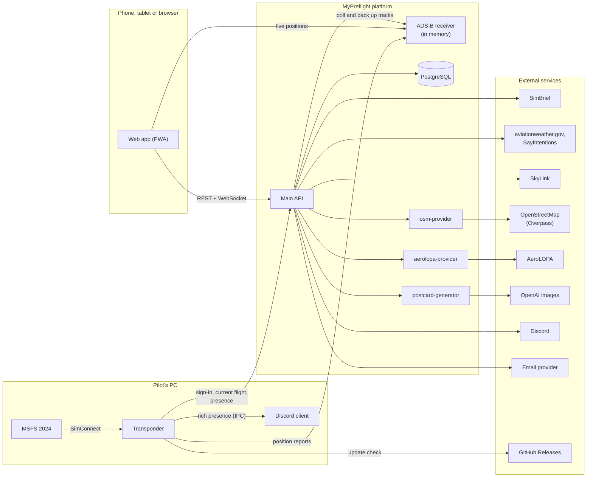

# Architecture

The components of MyPreflight and how they talk to each other.

Last reviewed: 2026-10-20

## At a glance

## Components

| Component | Role | Repo |
| --- | --- | --- |
| Web app | The SPA at app.mypreflight.io: dispatch, briefing, tracking, history, airport library. A PWA, static files only. | `app` |
| Main API | Accounts, flights and their lifecycle, loadsheets, manifests, cargo, weather, NOTAMs, airports, statistics, Discord bot, email, scheduled jobs. REST plus a Socket.IO event stream. | `api` |
| ADS-B receiver | In-memory ground station. Accepts position reports over HTTP per callsign and serves each callsign's track in time order. No database, to keep costs down; it restarts empty, like a power-cycled receiver. | `adsb` |
| Transponder | Windows console app with a tray icon on the sim PC. Reads MSFS 2024 through SimConnect, publishes positions under the current flight's callsign, mirrors Discord rich presence and checks for updates. See `../../product/transponder.md`. | `transponder` |
| OSM provider | Function reading one airport's boundary, runways, terminals, stands and gates from OpenStreetMap, in the platform's airport format | `osm` |
| AeroLOPA provider | Functions extracting seat maps, cabin configurations and the layout index from AeroLOPA | `aerolopa` |
| Postcard generator | Function drawing one travel poster per city with the OpenAI image API and storing it in object storage | `postcard` |
| Discord bot | Part of the API: DMs to the captain and server announcements, through Discord's REST API and gateway | `api` |
| Website | mypreflight.io: static marketing page with FAQ and machine-readable copies | `landing` |

## How data flows

### Planning

1. Operations import a flight from SimBrief. The API stores the plan, its NOTAMs, the crew roster and waypoints.
2. Airports the plan names that don't exist yet are created from SkyLink, at the lowest data-quality grade.
3. Writing the preliminary loadsheet, including the one the import writes, generates the passenger manifest (against the pinned AeroLOPA layout revision), the cargo manifest and the first NOTOC.

### Check-in to on-block

1. Check-in starts weather monitoring for the flight's airports and sends the Discord briefing.
2. The Transponder polls the API for the pilot's current flight. It switches to `MODE C` when boarding starts and back to `STBY` at on-block.
3. Position reports go to the ADS-B receiver every 10 seconds, every 30 seconds above 10,000 ft, plus immediately at takeoff and touchdown. Each carries callsign, time, latitude, longitude, altitude, vertical rate, squawk, ground speed, track, alert, emergency, SPI and on-ground.
4. The API checks the receiver every minute for each active flight's first live position and signals it once. Every five minutes it copies each flight's track into the database. Worst case, about five minutes of positions are lost if the receiver restarts.
5. From the stored path the API detects off-block (above 3 kt), takeoff (leaving the departure boundary) and arrival (inside the destination boundary below 50 kt).
6. The app subscribes to the flight's Socket.IO room (`/flight-events`) for lifecycle events, and polls the receiver directly for live positions once the first-position signal arrives.

### After the flight

- Closing the flight records the actual fuel burn and the completion facts. Statistics, passport stamps, aircraft history and postcards are recomputed or awarded from those.

## Scheduled jobs (main API)

| Every | Job |
| --- | --- |
| 1 min | Detect the first live position of active flights |
| 1 min | Watch boarding-finished flights for automatic off-block |
| 5 min | Back up flight tracks from the receiver |
| 5 min | Refresh weather for monitored airports |
| 5 min | Auto-approve undecided delay reports past their deadline |
| 1 min | Confirm postcards the generator has drawn |

## Authentication between components

- **Users** sign in to the API and get a short-lived JWT access token plus a refresh token. The app keeps them in the browser; the Transponder stores its refresh token encrypted with Windows DPAPI next to the executable.
- **Transponder to receiver:** a client bearer token for publishing positions.
- **API to receiver:** an admin bearer token for clearing a callsign's track.
- **API to provider functions:** a shared secret header.
- **WebSocket:** the same JWT, in the Socket.IO handshake. CabinCrew and Operations only.

## Data model in brief

| Area | Main records |
| --- | --- |
| Reference | Country, City, Airport (with boundary shape and data-quality grade), Runway, Terminal, Gate, ParkingPosition, Waypoint, airframe and hold catalogues (data files), CabinLayout and its versions |
| Airline | Operator, Aircraft (with cabin layout and hold variant), Crew, Rotation and legs |
| Flight | Flight, FlightLoadsheet, FlightPassenger, cargo and NOTOC records, FlightEvent, Diversion, EmergencyDeclaration, DelayRequest and DelayReport, ETOPS points and airports, route fixes, oceanic tracks |
| Pilot | User, UserTravel, UserAircraft, country and city visits, postcards, statistics projections |
| Curation | ChangeRequest |

The schema lives in the API repo (`prisma/schema.prisma`).
